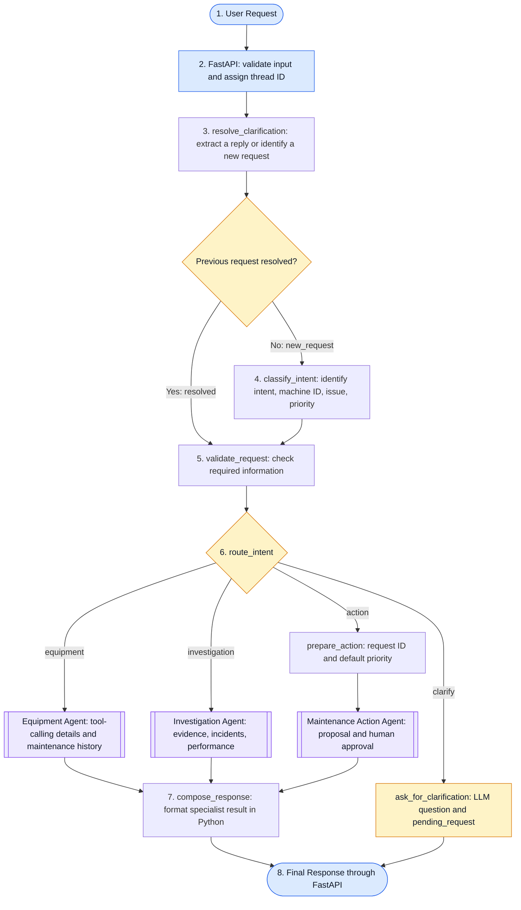
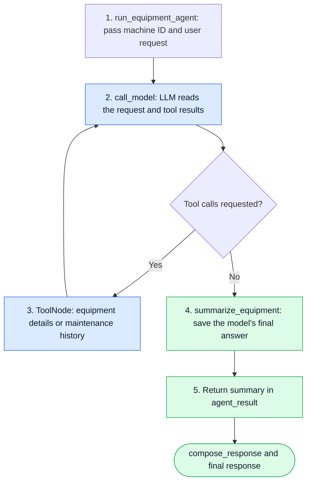
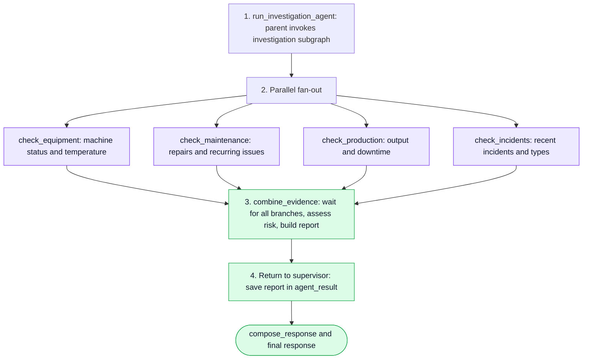
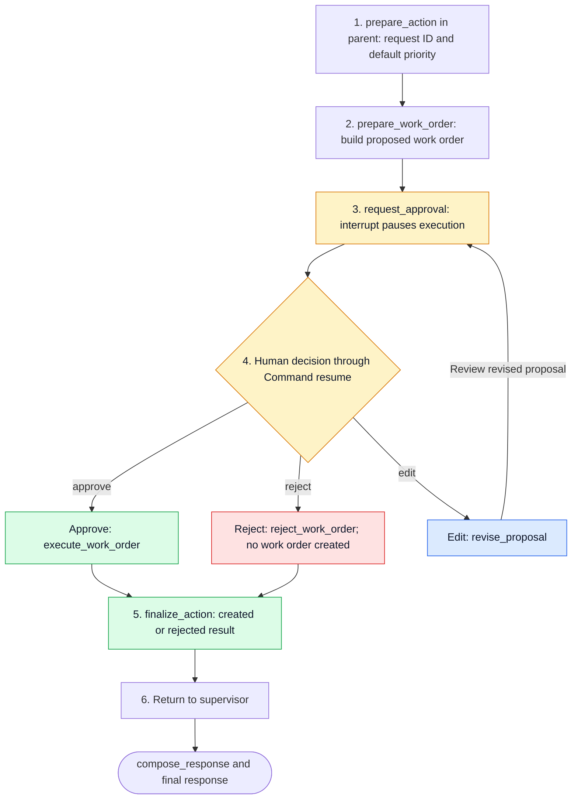
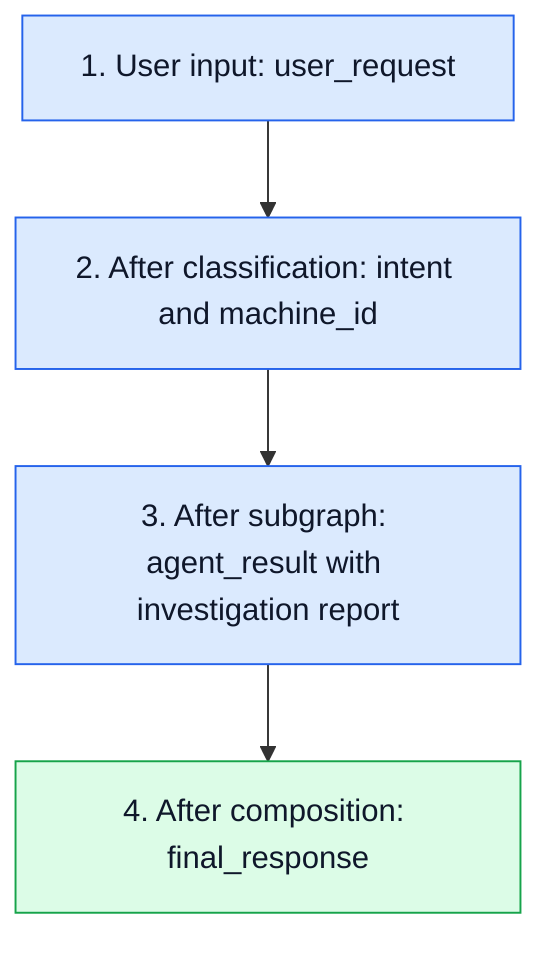

# 🏭 OpsPilot — Manufacturing Operations AI Agent

OpsPilot is a manufacturing operations assistant that turns natural-language requests into equipment answers, maintenance-history summaries, investigations, and maintenance work-order proposals. A LangGraph supervisor resolves follow-up questions, classifies intent, validates required information, and delegates work to specialist subgraphs. The Equipment Agent uses LLM tool calling, the Investigation Agent combines four evidence branches, and the Maintenance Action Agent pauses for human approval before creating a work order. Use the FastAPI endpoints or the interactive command-line interface to continue a conversation on the same thread.

Built with **LangGraph**, **FastAPI**, and **OpenAI**, the project demonstrates structured intent classification, conditional routing, parallel evidence collection, separate subgraph state, and resumable human approval over HTTP.

> 💡 **Example:** Ask “What's the status of M-103?”, investigate its recurring overheating, or explicitly request a cooling-system work order. The current equipment and investigation records are local sample data.

---

## ✨ What OpsPilot Does

| Capability | How it works |
|---|---|
| ⚙️ **Equipment information** | Uses an LLM tool loop to retrieve machine details and answer from tool results. |
| 📋 **Maintenance history** | Calls the maintenance-history tool for dated service records and recurring issues. |
| 🔎 **Investigation** | Collects equipment, maintenance, production, and incident evidence in four graph branches, then applies a risk score. |
| 🛠️ **Maintenance actions** | Prepares a work-order proposal and waits for approval, rejection, or edits. |
| 💬 **Clarification and follow-ups** | Preserves incomplete requests, extracts missing information from replies, and carries recent machine context within a thread. |
| 🌐 **HTTP and CLI access** | Supports API requests, existing-thread messages, approval decisions, state inspection, streaming, and an interactive terminal loop. |
| 🧠 **Workflow state** | Uses process-local checkpoints and an in-memory work-order store. |

LLMs handle intent classification, clarification extraction, question generation, and equipment tool selection and answers. Python enforces routing, required fields, investigation risk rules, approval gates, and final response formatting.

## 🎯 Business Outcomes and Agent Design

Customers have an IT budget that maps to some strategic priority, and they want to improve some business metrics that help them justify that spend.

So what are some ways we can optimize AI agents so that we can deliver business outcomes?

### 📝 Core Design Principle

> **The Supervisor coordinates decisions and delegates work. Specialized agents perform tasks. Python enforces routing and safety rules, while LLMs handle language understanding and response generation.**

The Supervisor Graph acts as the central orchestrator, receiving user requests, using an LLM to classify intent, validating required information, and routing tasks to the appropriate specialized subgraph. The Equipment Agent retrieves machine data, evaluates operating conditions, and identifies potential maintenance needs. The Investigation Agent performs deeper analysis by gathering evidence in parallel from equipment records, maintenance history, production performance, and incident reports, then combines the findings to identify potential root causes and recommend actions. The Maintenance Action Agent handles work-order creation, using human-in-the-loop approval to ensure no maintenance action is executed without authorization. Each subgraph manages its own internal nodes, tools, and state, then returns structured results to the Supervisor, which prepares the final response for the user.

**How this maps to the current code:** The Equipment Agent now uses an LLM to select tools and generate an answer from their results. The supervisor's request-handling module uses structured LLM outputs for classification and clarification extraction. Investigation aggregation, risk scoring, recommendation formatting, approval enforcement, and `compose_response` remain Python-controlled. Investigation reports summarize sample evidence; they do not establish a proven root cause.

## 🧰 Technology Stack

| Component | Technology |
|---|---|
| Orchestration | LangGraph `StateGraph`, conditional edges, and specialist subgraphs |
| Model | OpenAI `gpt-5-mini` through `ChatOpenAI` |
| Structured extraction | Pydantic `IntentClassification` and `ClarificationAnswer` schemas |
| Equipment tool loop | `bind_tools`, `ToolNode`, `tools_condition`, and the `add_messages` reducer |
| API | FastAPI and Uvicorn |
| Evidence aggregation | Four asynchronous graph branches with an explicit join and `operator.add` findings reducer |
| Human approval | LangGraph `interrupt()` and `Command(resume=...)` |
| Workflow checkpoints | `InMemorySaver` |
| Work-order storage | In-memory dictionary, deduplicated by request ID within the running process |
| Runtime | Python 3.12+ and `uv` |

---

## 🧭 Supervisor Workflow

The supervisor begins with `resolve_clarification`. For a known pending task, a structured LLM extractor checks whether the reply supplies missing information or starts a new request. A resolved task goes directly to validation. New requests are classified normally; an initially ambiguous pending request is combined with the reply and classified again. The graph handles one specialist intent per turn.

`supervisor.py` now assembles the graph and formats results. Request-handling nodes and specialist adapters live in `request_validation.py`.


> 📝 The supplied images are design references. The current Mermaid diagrams and state definitions below reflect the inspected implementation; the equipment reference image shows an earlier linear workflow.



Clarification returns its question directly without `compose_response`. The action branch can pause for approval before returning its final result. The graph registers `classify_intent`, `validate_request`, and `ask_for_clarification` under those same node names.

## 🔄 Shared State and Conversation Handling

### Parent State in `state.py`

The parent schema is now named `State` and is imported directly by the supervisor and request-handling module:

```python
class State(TypedDict):
    user_request: str
    intent: NotRequired[Literal[
        "equipment", "investigation", "action", "clarify"
    ]]
    machine_id: NotRequired[str]
    request_id: NotRequired[str]
    issue: NotRequired[str]
    priority: NotRequired[str]
    agent_result: NotRequired[dict]
    final_response: NotRequired[str]
    pending_request: NotRequired[dict | None]
    clarification_resolved: NotRequired[bool]
    missing_fields: NotRequired[list[str]]
    last_machine_id: NotRequired[str]
```

| Field or node | Current behavior |
|---|---|
| `missing_fields` | Validation identifies missing machine IDs, missing action issues, or an unclear task without overwriting the classified intent. |
| `pending_request` | Saves the original request, intent, machine ID, issue, priority, and missing-field list for a follow-up. |
| `ClarificationAnswer` | Extracts `answers_question`, `machine_id`, and `issue` from a natural-language reply using structured output. |
| `resolve_clarification` | Restores a known pending task from the answer, validates an extracted machine ID against `M-\d+`, and clears pending state before revalidation. |
| New or unrelated reply | Drops a known pending task and classifies the new request; an initially ambiguous task is combined with its follow-up and reclassified. |
| `clarification_resolved` | Resets to `False` when there is no pending request or the message needs classification; becomes `True` when a pending task is restored. |
| `last_machine_id` | Gives the classifier recent machine context for explicit references such as “it” or “that machine.” |

If a reply still leaves required information missing, validation routes back to a clarification question. The API now exposes `POST /threads/{thread_id}/messages` for these follow-ups. Clarification questions return `status: completed` while retaining `pending_request` in graph state; they are separate from approval interrupts.

### Interactive CLI

`main.py` keeps one thread ID for the entire terminal session, allowing clarification replies and references to the previously discussed machine. It prompts for `approve` or `reject` when a work order pauses. Use the HTTP approval endpoint when editing a proposal.

## ⚙️ Equipment Agent Subgraph

**Triggered by:** equipment details, status, or maintenance-history requests.


*Design reference: the image predates the tool-calling loop. The current workflow is shown below.*



`EquipmentState` contains `machine_id`, `user_request`, a `messages` list merged by `add_messages`, and the optional `equipment_summary`. Tool responses are added to the message history before the model decides whether to call another tool or answer.

| Tool | Result |
|---|---|
| `get_equipment_details` | Machine name, status, temperature, department, and installation year; a structured not-found result for an unknown ID. |
| `get_maintenance_history` | Dated maintenance records and recurring issue; an error for an unknown machine. |

**Examples:** `What's the status of M-103?` and `Show maintenance history for M-104.`

Tools read the shared records in `tools/equipment_db.py`, which covers **M-103**, **M-104**, and **M-105**. The model is instructed to answer only from tool results and report missing records. Equipment answers are model-generated, so exact wording and selected tool calls can vary.

## 🔎 Investigation Agent Subgraph

**Triggered by:** a request to investigate causes, recurring problems, incidents, or production performance.




**Example:** `Investigate why M-103 keeps overheating.`

| Evidence source | Current M-103 sample evidence |
|---|---|
| Equipment | `Maintenance Required`, temperature **85.5°C** |
| Maintenance | **3** recent repairs and a recurring cooling-system issue |
| Production | **820 / 1,000** target units, **18.0%** below target, and **95 minutes** of downtime |
| Incidents | **2** recent overheating incidents |

Each branch appends a finding through the `operator.add` reducer. The join waits for all four branches, sorts findings by source, and creates a Pydantic-validated report containing `machine_id`, `findings`, `risk_level`, `recommendation`, and `evidence_sources`.

Risk is now based on the number of these conditions that hold:

| Risk factor | Threshold |
|---|---|
| Equipment temperature | At least **85°C** |
| Recent incidents | At least **2** |
| Repair records in maintenance history | At least **3** |
| Production shortfall | At least **10%** below target |

**3–4 factors → high**, **1–2 factors → medium**, and **0 factors → low**. M-103 meets all four conditions. The recommendation names the recurring maintenance issue, for example `Schedule a maintenance review of: Cooling system.`

The branches share the records in `tools/equipment_db.py`. They form a parallel fan-out/fan-in graph, although the current lookups are immediate local dictionary reads. The report combines evidence and deterministic rules rather than proving a root cause.

> 📌 Use **M-103** for investigation examples. Other sample machines have null incident types, which the current incident formatter does not handle.

## 🛠️ Maintenance Action Agent Subgraph

**Triggered by:** an explicit request to create a maintenance work order.




**Example:** `Create a high-priority work order for M-103 to inspect the cooling system.`

1. The parent assigns a new request ID for each action request and defaults to `medium` priority if none was supplied.
2. The subgraph prepares the proposed machine, issue, priority, action, and estimated duration.
3. `interrupt()` pauses execution and returns the proposal for review.
4. A person submits **approve**, **reject**, or **edit** through the approval endpoint.
5. Approval allows execution, rejection ends without creation, and editing returns the revised proposal for approval again.

> 🔐 A work order is created only after a valid approval. Editing a proposal does not approve it.

The initial proposal uses the supplied issue, the fixed action **“Inspect and repair.”**, and an estimate of **120 minutes**. A reviewer can change `priority`, `estimated_minutes`, and `action` before approving.

Approved creation now calls `tools.work_orders.create_work_order`. Its in-memory dictionary returns the existing record for the same request ID, giving request-scoped duplicate prevention within the running process. Separate action requests receive different IDs, even if their wording is identical. Work orders are not durably stored.

## 🧠 How Graph State Moves Through the System

For a new investigation request with no pending clarification, the parent state evolves through these stages after the initial clarification check:



| Stage | Illustrative state fields |
|---|---|
| User input | `{"user_request": "Investigate why M-103 keeps overheating."}` |
| After classification | `{"intent": "investigation", "machine_id": "M-103"}` |
| After the subgraph | `{"agent_result": {"agent": "investigation", "report": {"machine_id": "M-103", "risk_level": "high"}}}` |
| After composition | `{"final_response": "Investigation: M-103..."}` |

These are abbreviated snapshots. Each node returns a **partial state update**, which LangGraph merges according to the schema and any reducers.

The parent `State` and each subgraph's private state are separate. Adapters pass required inputs into a child graph and copy its summary, report, or action result into the parent's `agent_result`. The action subgraph inherits checkpointing from the parent so approval can resume on the same thread.

The active `InMemorySaver` holds checkpoints for inspection and resumption **within the running process**. Restarting the server clears workflow state.

**New-request journey:** User → FastAPI → Resolve Clarification → Classify → Validate → Route → Specialist Subgraph → Return Result → Compose Response → User.

**Resolved-clarification journey:** Existing-thread message → Resolve Clarification → Validate → Route → Specialist Subgraph → Compose Response → User. A reply to an initially ambiguous task goes through classification again.

---

## 📁 Project Structure

Current application files and documentation:

```text
Ultimate LangGraph Agent/
├── agents/
│   ├── equipment_agent.py       # LLM tool-calling equipment subgraph
│   ├── investigation_agent.py   # Four evidence branches and risk scoring
│   └── maintenance_action.py    # Proposal, approval, revision, execution
├── api/
│   ├── __init__.py
│   └── main.py                  # FastAPI routes, messages, approvals, streaming
├── docs/
│   └── images/
│       ├── supervisor-architecture.png
│       ├── equipment-agent-subgraph.png
│       ├── investigation-agent-subgraph.png
│       └── maintenance-action-subgraph.png
├── evals/
│   └── golden_dataset.py        # Example requests and expected intent labels
├── tools/
│   ├── equipment_db.py          # Shared equipment and operational sample records
│   ├── equipment_tools.py       # Equipment-detail and maintenance-history tools
│   └── work_orders.py           # In-memory work-order creation and deduplication
├── .example.env                # Example environment variable configuration
├── .gitignore
├── main.py                     # Interactive multi-turn CLI
├── pyproject.toml              # Python requirements and dependencies
├── README.md
├── request_validation.py       # Clarification, classification, validation, adapters
├── schemas.py                  # Input, intent, clarification, approval schemas
├── state.py                    # Shared parent State schema
└── supervisor.py               # Graph assembly and final response composition
```

## 🚀 Run the API or CLI

### 1. Prepare the environment

Use **Python 3.12+** and **uv**. From PowerShell:

```powershell
Set-Location "C:\Users\Admin\Desktop\Ultimate LangGraph Agent"
uv sync
$env:OPENAI_API_KEY = "your_openai_api_key_here"
```

Set `OPENAI_API_KEY` in the terminal that will launch the application. The model is configured as `gpt-5-mini` in the request-handling module and Equipment Agent.

### 2. Start the API

```powershell
uv run uvicorn api.main:app --host 127.0.0.1 --port 8000
```

Keep this server process running while sending messages and approval decisions from a second terminal. Workflow state and work orders are held in memory.

| Resource | Address |
|---|---|
| API base URL | [http://127.0.0.1:8000](http://127.0.0.1:8000) |
| Interactive Swagger documentation | [http://127.0.0.1:8000/docs](http://127.0.0.1:8000/docs) |
| ReDoc documentation | [http://127.0.0.1:8000/redoc](http://127.0.0.1:8000/redoc) |
| OpenAPI schema | [http://127.0.0.1:8000/openapi.json](http://127.0.0.1:8000/openapi.json) |

### 3. Or use the interactive CLI

```powershell
uv run python main.py
```

Enter a request, answer any clarification question, and use `approve` or `reject` when prompted. Type `quit` or `exit` to end the session. The CLI and API are separate processes with separate in-memory stores.

---

## 🌐 API Endpoints

| Method | Endpoint | Purpose |
|---|---|---|
| `POST` | `/requests` | Start a workflow; return a completed response or an approval interrupt. |
| `POST` | `/requests/stream` | Start a workflow and stream parent graph updates as Server-Sent Events. |
| `POST` | `/threads/{thread_id}/messages` | Send a follow-up or clarification reply on an existing thread. |
| `POST` | `/threads/{thread_id}/approvals` | Resume a paused workflow with approval, rejection, or edits. |
| `GET` | `/threads/{thread_id}` | Inspect stored parent state and the next scheduled nodes. |
| `GET` | `/health` | Check whether the API process is responding. |

**Request body:** `/requests`, `/requests/stream`, and `/threads/{thread_id}/messages` accept a `message` string containing **1–2,000 characters**. The first two create new threads; the message endpoint continues an existing thread. Use messages for clarification replies and references such as “that machine.”

**Workflow statuses:** `completed` means the workflow returned a final response, including clarification or rejection. `awaiting_approval` means the workflow paused and requires a decision on the supplied thread ID.

**Approval body:** `action` must be `approve`, `reject`, or `edit`. Optional `changes` can contain:

| Field | Accepted value |
|---|---|
| `priority` | `low`, `medium`, or `high` |
| `estimated_minutes` | Integer from **15 to 480** |
| `action` | Work-order action text from **5 to 200 characters** |

Use `edit` to apply changes, then approve the revised proposal in a separate call. Unknown fields inside `changes` are rejected. The API supplies `reviewer_id` internally as `demo-supervisor`.

**HTTP errors:** Request-schema validation failures return `422`. An unknown thread on state inspection or message submission returns `404`. Messages submitted during a pending approval return `409`; use the approval endpoint instead. Approval submission without a pending approval interrupt also returns `409`.

> 📡 **Streaming behavior:** `/requests/stream` emits `data: <JSON>` frames containing node updates rather than model tokens. It does not currently expose the generated thread ID to the client or use the regular completed/approval response envelope. Use `/requests` for the approval workflow below.

## 💻 How to Invoke the API Using PowerShell

With the server running, open a **second PowerShell terminal**. These examples show response shapes rather than recorded executions. Generated IDs and model-written wording will vary.

### ⚙️ Ask for equipment status

```powershell
$body = @{
    message = "What's the status of M-103?"
} | ConvertTo-Json

$response = Invoke-RestMethod `
    -Uri "http://127.0.0.1:8000/requests" `
    -Method Post `
    -ContentType "application/json" `
    -Body $body

$response
```

Illustrative response shape; equipment wording is model-generated:

```json
{
  "thread_id": "generated-uuid",
  "status": "completed",
  "response": "M-103 is a CNC Milling Machine with status Maintenance Required and a temperature of 85.5°C."
}
```

### 💬 Continue the same conversation

After the equipment request above, retain its thread ID and ask about the same machine:

```powershell
$threadId = $response.thread_id

$body = @{
    message = "Show its maintenance history."
} | ConvertTo-Json

$response = Invoke-RestMethod `
    -Uri "http://127.0.0.1:8000/threads/$threadId/messages" `
    -Method Post `
    -ContentType "application/json" `
    -Body $body

$response
```

The classifier receives recent machine context, and the Equipment Agent can call `get_maintenance_history`. Reference resolution and tool selection are model-driven.

### ❓ Answer a clarification question

Start a request that is missing a machine ID:

```powershell
$body = @{
    message = "Show me a machine's maintenance history."
} | ConvertTo-Json

$response = Invoke-RestMethod `
    -Uri "http://127.0.0.1:8000/requests" `
    -Method Post `
    -ContentType "application/json" `
    -Body $body

$threadId = $response.thread_id
$response.response
```

Reply on that same thread:

```powershell
$body = @{
    message = "For machine M-103."
} | ConvertTo-Json

Invoke-RestMethod `
    -Uri "http://127.0.0.1:8000/threads/$threadId/messages" `
    -Method Post `
    -ContentType "application/json" `
    -Body $body
```

The resolver extracts the missing information and sends the restored task through validation. An answer that still lacks required details can lead to another question.

### 🔎 Start an investigation

```powershell
$body = @{
    message = "Investigate why M-103 keeps overheating."
} | ConvertTo-Json

Invoke-RestMethod `
    -Uri "http://127.0.0.1:8000/requests" `
    -Method Post `
    -ContentType "application/json" `
    -Body $body
```

The supervisor routes to the Investigation Agent, executes its four parallel branches, and returns a final report with findings, risk level, and recommendation.

### 🛠️ Submit a work-order request

```powershell
$body = @{
    message = "Create a high-priority work order for M-103 to inspect the cooling system."
} | ConvertTo-Json

$response = Invoke-RestMethod `
    -Uri "http://127.0.0.1:8000/requests" `
    -Method Post `
    -ContentType "application/json" `
    -Body $body

$response
```

Expected response shape:

```json
{
  "thread_id": "generated-uuid",
  "status": "awaiting_approval",
  "interrupt": {
    "type": "maintenance_approval",
    "proposal": {
      "request_id": "generated-request-uuid",
      "machine_id": "M-103",
      "issue": "Inspect the cooling system",
      "priority": "high",
      "action": "Inspect and repair.",
      "estimated_minutes": 120
    },
    "allowed_actions": ["approve", "reject", "edit"]
  }
}
```

Extracted `issue` wording can vary. Save the thread ID and inspect the proposal:

```powershell
$threadId = $response.thread_id
$response.interrupt.proposal
```

### ✅ Approve the proposed work order

```powershell
$approval = @{
    action = "approve"
} | ConvertTo-Json

$result = Invoke-RestMethod `
    -Uri "http://127.0.0.1:8000/threads/$threadId/approvals" `
    -Method Post `
    -ContentType "application/json" `
    -Body $approval

$result
```

Expected final response shape, once approved creation succeeds:

```json
{
  "thread_id": "generated-uuid",
  "status": "completed",
  "response": "Work order WO-... was created for M-103."
}
```

### ✏️ Edit a proposal before approving

For a thread **still awaiting approval**, submit changes instead of approval:

```powershell
$revision = @{
    action = "edit"
    changes = @{
        priority = "high"
        estimated_minutes = 90
        action = "Inspect the cooling system and temperature sensors."
    }
} | ConvertTo-Json -Depth 4

$response = Invoke-RestMethod `
    -Uri "http://127.0.0.1:8000/threads/$threadId/approvals" `
    -Method Post `
    -ContentType "application/json" `
    -Body $revision

$response
```

The response remains `awaiting_approval` and contains the revised proposal. Review it, then use the approval call above on the same thread.

### ❌ Reject a proposal

For a thread **still awaiting approval**:

```powershell
$rejection = @{
    action = "reject"
} | ConvertTo-Json

Invoke-RestMethod `
    -Uri "http://127.0.0.1:8000/threads/$threadId/approvals" `
    -Method Post `
    -ContentType "application/json" `
    -Body $rejection
```

The workflow completes with a rejection message and creates no work order. Approval, editing, and rejection are alternatives for a pending proposal; a completed thread cannot be approved again.

### 🧠 Inspect workflow state

```powershell
Invoke-RestMethod `
    -Uri "http://127.0.0.1:8000/threads/$threadId" `
    -Method Get
```

The response contains `thread_id`, `state`, and `next`, rather than the formatted response envelope used by `/requests`.

### 💚 Check API health

```powershell
Invoke-RestMethod -Uri "http://127.0.0.1:8000/health" -Method Get
```

```json
{
  "status": "ok",
  "service": "opspilot"
}
```

This reports API process health; it does not check OpenAI connectivity or work-order storage.

---

## 💬 Sample Prompts

| Goal | Prompt | Expected route |
|---|---|---|
| Check a machine requiring maintenance | “What's the status of M-103?” | Equipment |
| Check an operational machine | “Is M-104 operational?” | Equipment |
| Check an offline machine | “Check the status of M-105.” | Equipment |
| Investigate recurring overheating | “Investigate why M-103 keeps overheating.” | Investigation |
| Investigate output loss | “Investigate production losses on M-103.” | Investigation |
| Propose maintenance | “Create a high-priority work order for M-103 to inspect the cooling system.” | Action → human approval |
| Request without a machine ID | “Check the machine.” | Clarification |
| Retrieve service records | “Show maintenance history for M-104.” | Equipment tool loop |
| Refer to the last machine | “Show its maintenance history.” | Existing-thread message → equipment |

Classification is model-driven, so these are expected routes rather than guaranteed classifier results. Send context-dependent prompts through the existing-thread message endpoint or CLI. An investigation reads all four evidence sources regardless of the symptom mentioned.

## 🚀 Agent Optimization Techniques

Customers want measurable business outcomes from their AI investment. To overcome this challenge, we need to use agent optimization techniques. There are many techniques out there, but here are a few of my favourite ones that don't depend on fine-tuning the LLM. Let's consider our example here.

> 🧪 **Proposed improvements:** GEPA, MIPROv2, Reflexion, and ExpeL are ideas for extending OpsPilot. They are not implemented in this repository, and no improvement in business metrics has been measured here.

### ➡️ Technique: GEPA (Genetic-Pareto)

**❓ How would we apply it?** Run evaluation cases, analyze failed traces, and optimize prompts offline.

**👉 Approach:** Use execution feedback to evolve classifier and clarification prompts, compare candidates against held-out cases, and retain improvements before deployment. This applies GEPA's reflective prompt-optimization approach to OpsPilot. [GEPA paper](https://arxiv.org/abs/2507.19457)

### ➡️ Technique: MIPROv2 (Multi-prompt Instruction Proposal Optimizer Version 2)

**❓ How would we apply it?** Improve `classify_intent` accuracy for equipment, investigation, maintenance action, and clarification requests.

**👉 Approach:** Optimize instructions and few-shot examples using labeled requests. A DSPy-compatible classifier wrapper and an evaluation metric would be needed to apply MIPROv2; it is not currently a dependency or part of the LangGraph execution path. [DSPy MIPROv2 documentation](https://dspy.ai/current/api/optimizers/MIPROv2/)

### ➡️ Technique: Reflexion

**❓ How would we apply it?** When the Investigation Agent produces a weak or unsupported conclusion, have it critique the result and retry with a different search strategy.

**👉 Approach:** Add `evaluate_result → reflect → retry` nodes with a maximum retry count, and retain reflection feedback for the next attempt. The present investigation only reads fixed local records, so a different search strategy would require additional evidence-retrieval capabilities. [Reflexion paper](https://arxiv.org/abs/2303.11366)

### ➡️ Technique: ExpeL (Experiential Learning)

**❓ How would we apply it?** Remember successful investigation strategies from previous incidents and reuse them for similar machines or failures.

**👉 Approach:** Extract lessons after completed investigations and store them in long-term memory, then retrieve relevant lessons for future cases. This would be a separate capability from the current process-local workflow checkpoints. [ExpeL paper](https://arxiv.org/abs/2308.10144)

### 📊 Connect Optimization to Outcomes

The supplied architecture highlights **intent classification, routing accuracy, clarification handling, investigation quality, approval enforcement, tool failures, and duplicate work-order prevention** as evaluation areas. These are candidate evaluation targets, not a claim that a complete benchmark has already been run.

For a business-facing evaluation, measure task quality alongside **resolution time**, **human review effort**, **cost per completed request**, and **work-order duplication rate**. Compare each proposed technique against a baseline and preserve the approval gate throughout optimization.

## 📌 Current Implementation Notes

- **Sample operational data:** Equipment tools and investigation branches read the shared dictionaries in `tools/equipment_db.py`, rather than live plant systems.
- **Single specialist intent per turn:** The supervisor does not decompose a combined request into several tasks. Use separate turns for status, investigation, and action requests.
- **Process-local storage:** Server restarts clear workflow checkpoints and work orders. Separate API workers or CLI processes do not share state.
- **Request-scoped deduplication:** The work-order tool prevents repeated creation for the same request ID within a process. It does not detect identical requests submitted under different IDs or provide durable duplicate prevention.
- **Investigation edge cases:** The incident formatter calls `.lower()` on `incident_type`, which is `None` for M-104 and M-105. It also uses a fixed “Two recent” phrase rather than the stored count. Unknown investigation IDs use direct dictionary indexing. Use M-103 for the documented investigation path until these cases are handled.
- **Approval identity:** HTTP approvals use the fixed reviewer `demo-supervisor`; the CLI supplies `local-tester`. Authenticated reviewer identity is not implemented.
- **Model-dependent behavior:** Intent extraction, clarification extraction, recent-machine references, equipment tool selection, and equipment answer wording depend on LLM output.

The README reflects inspected source code. The retained design images are reference material, and the examples do not claim a recorded end-to-end execution or measured optimization gains.
