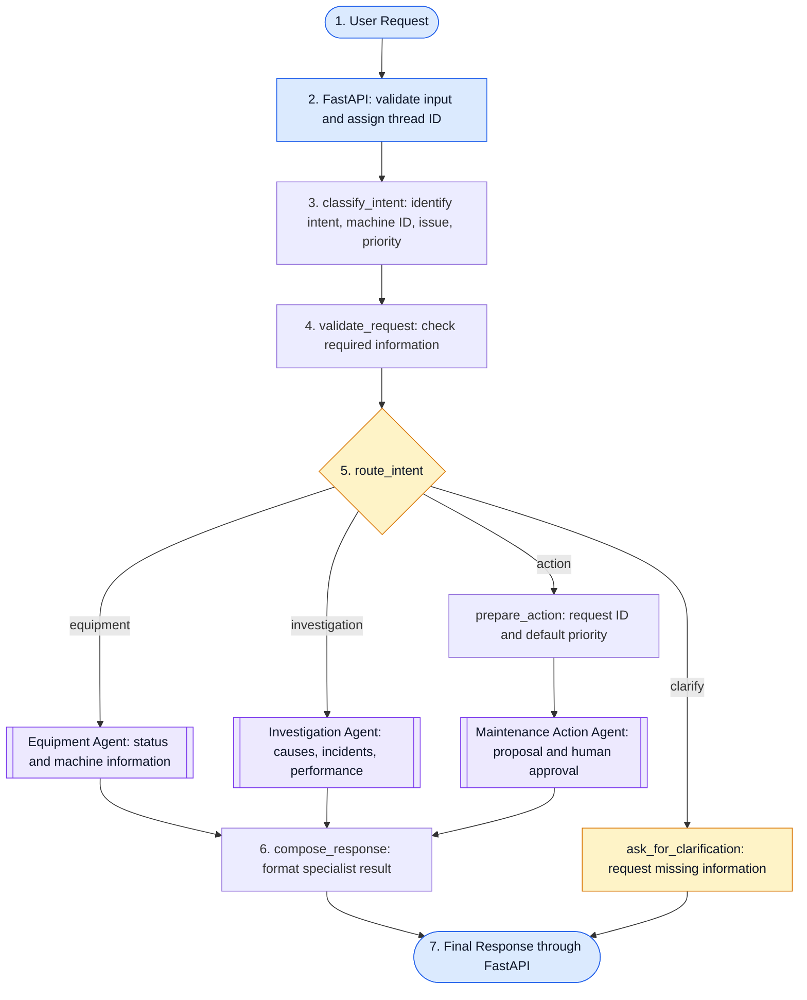
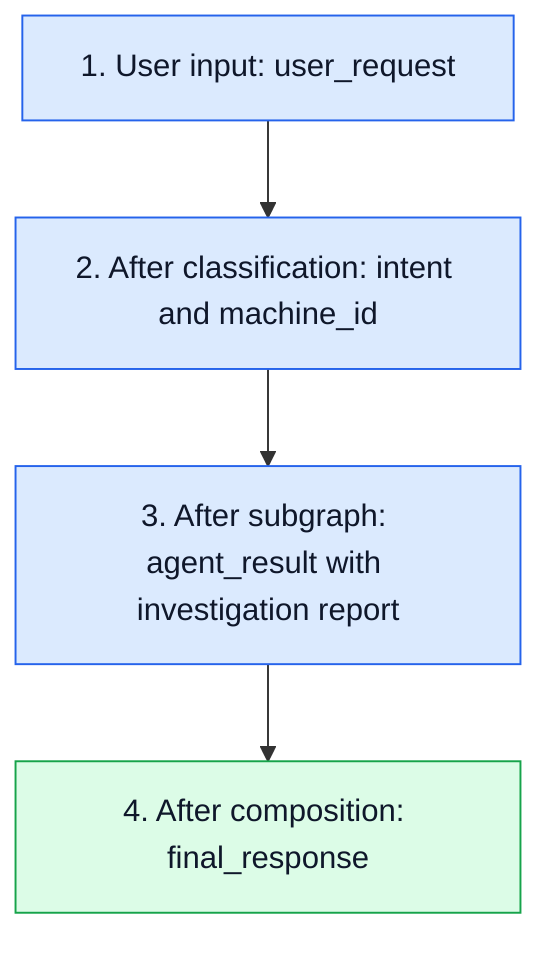

# 🏭 OpsPilot — Manufacturing Operations AI Agent

OpsPilot is a manufacturing operations assistant that turns natural-language requests into equipment status summaries, investigations, and maintenance work-order proposals. A LangGraph supervisor classifies each request, validates the required information, and routes it to a specialist subgraph. Investigations collect evidence across four parallel branches, while maintenance actions pause for human approval before a work order can be created.

Built with **LangGraph**, **FastAPI**, and **OpenAI**, the project demonstrates structured intent classification, conditional routing, parallel evidence collection, separate subgraph state, and resumable human approval over HTTP.

> 💡 **Example:** Ask “What's the status of M-103?”, investigate its recurring overheating, or explicitly request a cooling-system work order. The current equipment and investigation records are local sample data.

---

## ✨ What OpsPilot Does

| Capability | How it works |
|---|---|
| ⚙️ **Equipment status** | Retrieves a machine record, assesses whether maintenance review is needed, and returns a summary. |
| 🔎 **Investigation** | Checks equipment, maintenance, production, and incidents in parallel, then combines the findings into a structured report. |
| 🛠️ **Maintenance actions** | Prepares a work-order proposal and waits for a person to approve, reject, or edit it. |
| 💬 **Clarification** | Requests clarification for ambiguous, unsupported, or incomplete requests. |
| 🌐 **HTTP access** | Exposes request submission, approval, state inspection, health, and streaming endpoints. |
| 🧠 **Workflow state** | Tracks requests under generated thread IDs and supports approval resumption within the running server process. |

The LLM interprets intent. Application code enforces required fields, selects routes, applies investigation risk rules, and controls execution.

## 🧰 Technology Stack

| Component | Technology |
|---|---|
| Orchestration | LangGraph `StateGraph`, conditional edges, and specialist subgraphs |
| Intent classification | OpenAI `gpt-4.1-mini` through `ChatOpenAI` with structured output |
| API | FastAPI and Uvicorn |
| Validation | Pydantic models and typed state schemas |
| Parallel investigation | Asynchronous branches with an explicit join |
| Human approval | LangGraph `interrupt()` and `Command(resume=...)` |
| Active workflow checkpoints | `InMemorySaver` |
| Companion storage helper | SQLite in `tools/work_orders_db.py`; see implementation notes |
| Runtime | Python 3.12+ and `uv` |

---

## 🧭 Supervisor Workflow

The supervisor handles one classified intent per request, passes the necessary inputs into the selected subgraph, and formats the result for the user.



> 📝 Clarification returns directly without `compose_response`. The action branch can pause for human approval before returning its final result. Diagrams use function names; graph registration keys are sometimes shorter, such as `classify` and `validate`.

## ⚙️ Equipment Agent Subgraph

**Triggered by:** a request for a machine's status or information.


**Example:** `What's the status of M-103?`

The agent retrieves M-103, sees `Maintenance Required`, and returns:

> Machine M-103 has status 'Maintenance Required' and requires maintenance review.

The subgraph includes **M-103**, **M-104**, and **M-105**. Both `Maintenance Required` and `Offline` trigger maintenance review. An unknown machine returns a not-found summary.

## 🔎 Investigation Agent Subgraph

**Triggered by:** a request to investigate causes, recurring problems, incidents, or production performance.


**Example:** `Investigate why M-103 keeps overheating.`

| Evidence source | Current M-103 sample evidence |
|---|---|
| Equipment | `Maintenance Required`, temperature **85.5°C** |
| Maintenance | **3** recent repairs and a recurring cooling-system issue |
| Production | **820 / 1,000** target units, **18.0%** below target, and **95 minutes** of downtime |
| Incidents | **2** recent overheating incidents |

Each branch appends a finding through the `operator.add` reducer. The join waits for all four branches, sorts findings by source, and creates a Pydantic-validated report containing `machine_id`, `findings`, `risk_level`, `recommendation`, and `evidence_sources`.

The current rule assigns **high** risk when temperature is at least **85°C** and there are at least **2** recent incidents; otherwise it assigns **medium** risk. The recommendation is to review the cooling system and temperature sensors. This combines sample evidence and a fixed rule; it does not establish a proven root cause.

> 📌 Investigation records currently cover **M-103 only**. Use M-103 for the investigation examples below.

## 🛠️ Maintenance Action Agent Subgraph

**Triggered by:** an explicit request to create a maintenance work order.


**Example:** `Create a high-priority work order for M-103 to inspect the cooling system.`

1. The parent assigns a request ID and defaults to `medium` priority if none was supplied.
2. The subgraph prepares the proposed machine, issue, priority, action, and estimated duration.
3. `interrupt()` pauses execution and returns the proposal for review.
4. A person submits **approve**, **reject**, or **edit** through the approval endpoint.
5. Approval allows execution, rejection ends without creation, and editing returns the revised proposal for approval again.

> 🔐 A work order is created only after a valid approval. Editing a proposal does not approve it.

The initial proposal currently uses the fixed action **“Inspect and repair the cooling system.”** and an estimate of **120 minutes**. A reviewer can change `priority`, `estimated_minutes`, and `action` before approving.

## 🧠 How Graph State Moves Through the System

For an investigation request, the parent state evolves through four stages:



| Stage | Illustrative state fields |
|---|---|
| User input | `{"user_request": "Investigate why M-103 keeps overheating."}` |
| After classification | `{"intent": "investigation", "machine_id": "M-103"}` |
| After the subgraph | `{"agent_result": {"agent": "investigation", "report": {"machine_id": "M-103", "risk_level": "high"}}}` |
| After composition | `{"final_response": "Investigation: M-103..."}` |

These are abbreviated snapshots. Each node returns a **partial state update**, which LangGraph merges according to the schema and any reducers.

The parent `OpsPilotState` and each subgraph's private state are separate. Adapters pass required inputs into a child graph and copy its summary, report, or action result into the parent's `agent_result`. The action subgraph inherits checkpointing from the parent so approval can resume on the same thread.

The active `InMemorySaver` holds checkpoints for inspection and resumption **within the running process**. Restarting the server clears workflow state.

**Request journey:** User → FastAPI → Supervisor → Classify → Validate → Route → Specialist Subgraph → Return Result → Compose Response → User.

---

## 📁 Project Structure

The existing project layout is shown below. Virtual environments, caches, Git internals, and the excluded legacy folder are omitted.

```text
Ultimate LangGraph Agent/
├── agents/
│   ├── __init__.py
│   ├── equipment_agent.py       # Equipment lookup, assessment, and summary
│   ├── investigation_agent.py   # Parallel branches and evidence aggregation
│   └── maintenance_action.py    # Proposal, approval, revision, and execution
├── api/
│   ├── __init__.py
│   └── main.py                  # FastAPI routes and response formatting
├── evals/
│   └── golden_dataset.py        # Example requests and expected intent labels
├── tests/
│   ├── integration_test.py      # Investigation workflow checks
│   ├── risk_assessment_test.py  # Risk checks with a legacy dependency
│   └── test_api.py              # API validation and response checks
├── tools/
│   ├── __init__.py
│   ├── equipment.py             # Equipment-detail and maintenance-history tools
│   └── work_orders_db.py        # SQLite work-order storage helper
├── .env                        # Local configuration; Git-ignored
├── .gitignore
├── pyproject.toml              # Python version and dependency definitions
├── README.md
├── schemas.py                  # Structured classification schema
├── state.py                    # Parent supervisor state definition
├── supervisor.py               # Classification, validation, routing, adapters
└── uv.lock                     # Locked dependency versions
```

## 🚀 Run the API

### 1. Prepare the environment

Use **Python 3.12+** and **uv**. From PowerShell:

```powershell
Set-Location "C:\Users\Admin\Desktop\Ultimate LangGraph Agent"
uv sync --locked
```

Create or update a local `.env` file with your OpenAI API key:

```dotenv
OPENAI_API_KEY=your_openai_api_key_here
```

The supervisor loads this file with `python-dotenv` and uses `gpt-4.1-mini` for classification.

> 📌 **Current checkout dependency:** `supervisor.py` still imports `old.schemas` and `old.state`, and `agents/maintenance_action.py` imports `old.work_orders`. Those imports must resolve for the API to start. The excluded folder was not inspected for this README; the documented files alone are not yet a standalone runtime.

### 2. Start the server

From the project root, with the current import dependencies available:

```powershell
uv run uvicorn api.main:app --host 127.0.0.1 --port 8000
```

Keep this terminal running while invoking the API from a second terminal. Keep the same server process running between submitting a proposal and approving it.

| Resource | Address |
|---|---|
| API base URL | [http://127.0.0.1:8000](http://127.0.0.1:8000) |
| Interactive Swagger documentation | [http://127.0.0.1:8000/docs](http://127.0.0.1:8000/docs) |
| ReDoc documentation | [http://127.0.0.1:8000/redoc](http://127.0.0.1:8000/redoc) |
| OpenAPI schema | [http://127.0.0.1:8000/openapi.json](http://127.0.0.1:8000/openapi.json) |

---

## 🌐 API Endpoints

| Method | Endpoint | Purpose |
|---|---|---|
| `POST` | `/requests` | Start a workflow; return a completed response or an approval interrupt. |
| `POST` | `/requests/stream` | Start a workflow and stream parent graph updates as Server-Sent Events. |
| `POST` | `/threads/{thread_id}/approvals` | Resume a paused workflow with approval, rejection, or edits. |
| `GET` | `/threads/{thread_id}` | Inspect stored parent state and the next scheduled nodes. |
| `GET` | `/health` | Check whether the API process is responding. |

**Request body:** `/requests` and `/requests/stream` accept a `message` string containing **1–2,000 characters**. Each submission creates a new thread; `/requests` does not append follow-up messages to an existing thread.

**Workflow statuses:** `completed` means the workflow returned a final response, including clarification or rejection. `awaiting_approval` means the workflow paused and requires a decision on the supplied thread ID.

**Approval body:** `action` must be `approve`, `reject`, or `edit`. Optional `changes` can contain:

| Field | Accepted value |
|---|---|
| `priority` | `low`, `medium`, or `high` |
| `estimated_minutes` | Integer from **15 to 480** |
| `action` | Work-order action text from **5 to 200 characters** |

Use `edit` to apply changes, then approve the revised proposal in a separate call. Unknown fields inside `changes` are rejected. The API supplies `reviewer_id` internally as `demo-supervisor`.

**HTTP errors:** Request-schema validation failures return `422`; an unknown thread on state inspection returns `404`; submitting approval when no approval interrupt is pending returns `409`.

> 📡 **Streaming behavior:** `/requests/stream` emits `data: <JSON>` frames containing node updates rather than model tokens. It does not currently expose the generated thread ID to the client or use the regular completed/approval response envelope. Use `/requests` for the approval workflow below.

## 💻 How to Invoke the API Using PowerShell

With the server running, open a **second PowerShell terminal**. These responses illustrate code-defined behavior; generated IDs will vary.

### ⚙️ Ask for equipment status

```powershell
$body = @{
    message = "What's the status of M-103?"
} | ConvertTo-Json

$response = Invoke-RestMethod `
    -Uri "http://127.0.0.1:8000/requests" `
    -Method Post `
    -ContentType "application/json" `
    -Body $body

$response
```

Expected response shape:

```json
{
  "thread_id": "generated-uuid",
  "status": "completed",
  "response": "Machine M-103 has status 'Maintenance Required' and requires maintenance review."
}
```

### 🔎 Start an investigation

```powershell
$body = @{
    message = "Investigate why M-103 keeps overheating."
} | ConvertTo-Json

Invoke-RestMethod `
    -Uri "http://127.0.0.1:8000/requests" `
    -Method Post `
    -ContentType "application/json" `
    -Body $body
```

The supervisor routes to the Investigation Agent, executes its four parallel branches, and returns a final report with findings, risk level, and recommendation.

### 🛠️ Submit a work-order request

```powershell
$body = @{
    message = "Create a high-priority work order for M-103 to inspect the cooling system."
} | ConvertTo-Json

$response = Invoke-RestMethod `
    -Uri "http://127.0.0.1:8000/requests" `
    -Method Post `
    -ContentType "application/json" `
    -Body $body

$response
```

Expected response shape:

```json
{
  "thread_id": "generated-uuid",
  "status": "awaiting_approval",
  "interrupt": {
    "type": "maintenance_approval",
    "proposal": {
      "request_id": "generated-request-uuid",
      "machine_id": "M-103",
      "issue": "Inspect the cooling system",
      "priority": "high",
      "action": "Inspect and repair the cooling system.",
      "estimated_minutes": 120
    },
    "allowed_actions": ["approve", "reject", "edit"]
  }
}
```

Extracted `issue` wording can vary. Save the thread ID and inspect the proposal:

```powershell
$threadId = $response.thread_id
$response.interrupt.proposal
```

### ✅ Approve the proposed work order

```powershell
$approval = @{
    action = "approve"
} | ConvertTo-Json

$result = Invoke-RestMethod `
    -Uri "http://127.0.0.1:8000/threads/$threadId/approvals" `
    -Method Post `
    -ContentType "application/json" `
    -Body $approval

$result
```

Expected final response shape, once approved creation succeeds:

```json
{
  "thread_id": "generated-uuid",
  "status": "completed",
  "response": "Work order WO-... was created for M-103."
}
```

### ✏️ Edit a proposal before approving

For a thread **still awaiting approval**, submit changes instead of approval:

```powershell
$revision = @{
    action = "edit"
    changes = @{
        priority = "high"
        estimated_minutes = 90
        action = "Inspect the cooling system and temperature sensors."
    }
} | ConvertTo-Json -Depth 4

$response = Invoke-RestMethod `
    -Uri "http://127.0.0.1:8000/threads/$threadId/approvals" `
    -Method Post `
    -ContentType "application/json" `
    -Body $revision

$response
```

The response remains `awaiting_approval` and contains the revised proposal. Review it, then use the approval call above on the same thread.

### ❌ Reject a proposal

For a thread **still awaiting approval**:

```powershell
$rejection = @{
    action = "reject"
} | ConvertTo-Json

Invoke-RestMethod `
    -Uri "http://127.0.0.1:8000/threads/$threadId/approvals" `
    -Method Post `
    -ContentType "application/json" `
    -Body $rejection
```

The workflow completes with a rejection message and creates no work order. Approval, editing, and rejection are alternatives for a pending proposal; a completed thread cannot be approved again.

### 🧠 Inspect workflow state

```powershell
Invoke-RestMethod `
    -Uri "http://127.0.0.1:8000/threads/$threadId" `
    -Method Get
```

The response contains `thread_id`, `state`, and `next`, rather than the formatted response envelope used by `/requests`.

### 💚 Check API health

```powershell
Invoke-RestMethod -Uri "http://127.0.0.1:8000/health" -Method Get
```

```json
{
  "status": "ok",
  "service": "opspilot"
}
```

This reports API process health; it does not check OpenAI connectivity or work-order storage.

---

## 💬 Sample Prompts

| Goal | Prompt | Expected route |
|---|---|---|
| Check a machine requiring maintenance | “What's the status of M-103?” | Equipment |
| Check an operational machine | “Is M-104 operational?” | Equipment |
| Check an offline machine | “Check the status of M-105.” | Equipment |
| Investigate recurring overheating | “Investigate why M-103 keeps overheating.” | Investigation |
| Investigate output loss | “Investigate production losses on M-103.” | Investigation |
| Propose maintenance | “Create a high-priority work order for M-103 to inspect the cooling system.” | Action → human approval |
| Request without a machine ID | “Check the machine.” | Clarification |

Classification is model-driven, so these are expected routes rather than guaranteed classifier results. An investigation reads all four evidence sources regardless of which symptom is mentioned.

## 📌 Current Implementation Notes

- **Local sample records:** Equipment and investigation branches read in-code dictionaries rather than live plant systems.
- **Single intent per request:** The supervisor does not decompose a combined request into multiple specialist tasks. Submit status, investigation, and action requests separately.
- **In-memory checkpoints:** Pending approvals and inspectable thread state are lost on server restart. The installed SQLite checkpoint package is not the active checkpointer.
- **Work-order storage wiring:** `tools/work_orders_db.py` provides a SQLite helper with request-ID deduplication using a primary key and `INSERT OR IGNORE`. The active action subgraph imports creation from the excluded legacy module instead, so this helper's durable/idempotent behavior is not established for the active API path.
- **Tool wiring:** `tools/equipment.py` defines equipment-detail and maintenance-history tools, but the current equipment subgraph uses its own lookup and summary nodes. Maintenance-history retrieval is not connected to that route.
- **Approval identity:** The API currently uses the fixed reviewer `demo-supervisor`; authenticated reviewer identity is not implemented.

The diagrams and examples describe the inspected application flow and supplied reference images. They do not represent a recorded end-to-end execution.
