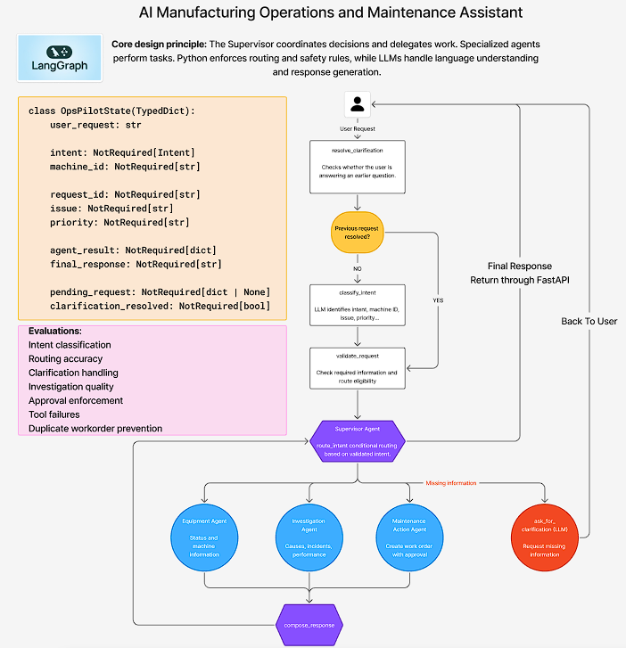
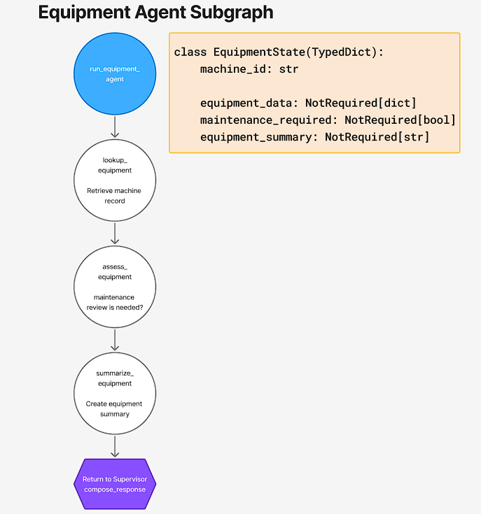
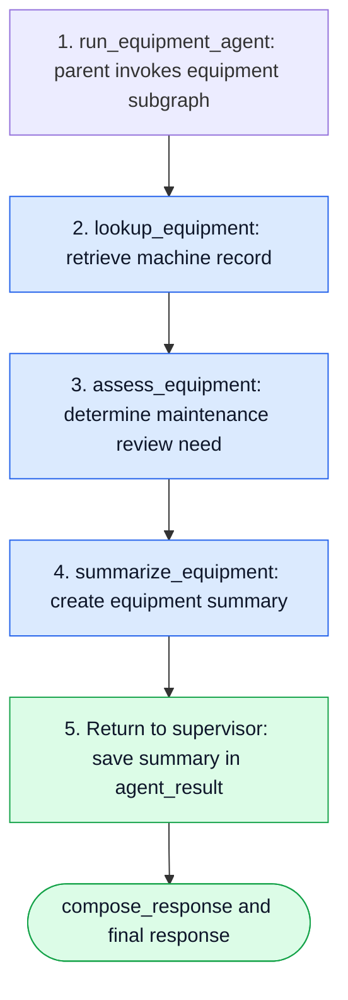
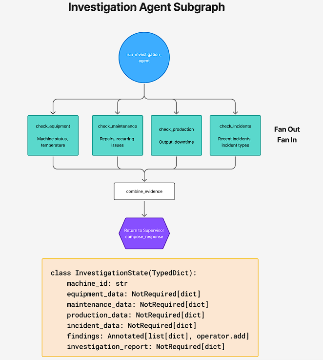
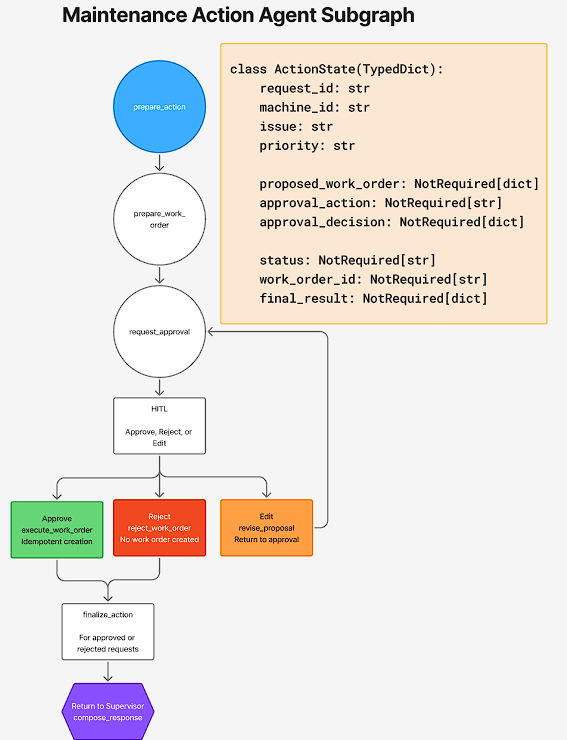
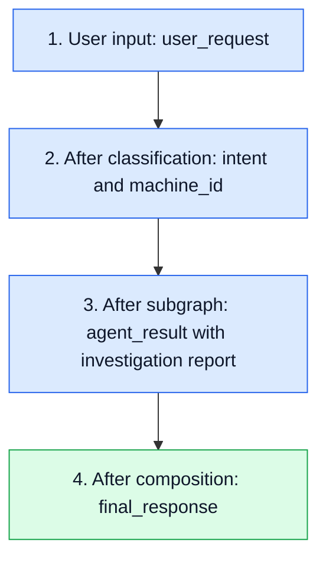

# 🏭 OpsPilot — Manufacturing Operations AI Agent

OpsPilot is a manufacturing operations assistant that turns natural-language requests into equipment status summaries, investigations, and maintenance work-order proposals. A LangGraph supervisor classifies each request, validates the required information, and routes it to a specialist subgraph. Investigations collect evidence across four parallel branches, while maintenance actions pause for human approval before a work order can be created.

Built with **LangGraph**, **FastAPI**, and **OpenAI**, the project demonstrates structured intent classification, conditional routing, parallel evidence collection, separate subgraph state, and resumable human approval over HTTP.

> 💡 **Example:** Ask “What's the status of M-103?”, investigate its recurring overheating, or explicitly request a cooling-system work order. The current equipment and investigation records are local sample data.

---

## ✨ What OpsPilot Does

| Capability | How it works |
|---|---|
| ⚙️ **Equipment status** | Retrieves a machine record, assesses whether maintenance review is needed, and returns a summary. |
| 🔎 **Investigation** | Checks equipment, maintenance, production, and incidents in parallel, then combines the findings into a structured report. |
| 🛠️ **Maintenance actions** | Prepares a work-order proposal and waits for a person to approve, reject, or edit it. |
| 💬 **Clarification** | Adds LLM-written questions and a pending-request resolver; end-to-end wiring is still in progress. |
| 🌐 **HTTP access** | Exposes request submission, approval, state inspection, health, and streaming endpoints. |
| 🧠 **Workflow state** | Tracks requests under generated thread IDs and supports approval resumption within the running server process. |

The LLM interprets intent and now generates clarification questions. Application code enforces required fields, selects routes, applies investigation risk rules, and controls execution. Final specialist responses are currently formatted by Python.

## 🎯 Business Outcomes and Agent Design

Customers have an IT budget that maps to some strategic priority, and they want to improve some business metrics that help them justify that spend.

So what are some ways we can optimize AI agents so that we can deliver business outcomes?

### 📝 Core Design Principle

> **The Supervisor coordinates decisions and delegates work. Specialized agents perform tasks. Python enforces routing and safety rules, while LLMs handle language understanding and response generation.**

The Supervisor Graph acts as the central orchestrator, receiving user requests, using an LLM to classify intent, validating required information, and routing tasks to the appropriate specialized subgraph. The Equipment Agent retrieves machine data, evaluates operating conditions, and identifies potential maintenance needs. The Investigation Agent performs deeper analysis by gathering evidence in parallel from equipment records, maintenance history, production performance, and incident reports, then combines the findings to identify potential root causes and recommend actions. The Maintenance Action Agent handles work-order creation, using human-in-the-loop approval to ensure no maintenance action is executed without authorization. Each subgraph manages its own internal nodes, tools, and state, then returns structured results to the Supervisor, which prepares the final response for the user.

**How this maps to the current code:** The LLM handles intent classification and clarification wording. Specialist lookups, investigation aggregation and risk assessment, and `compose_response` use deterministic Python. The investigation currently produces a fixed recommendation from sample evidence; broader root-cause reasoning and LLM-generated final reports are design directions rather than implemented capabilities.

## 🧰 Technology Stack

| Component | Technology |
|---|---|
| Orchestration | LangGraph `StateGraph`, conditional edges, and specialist subgraphs |
| Language understanding and clarification | OpenAI `gpt-5-mini` through `ChatOpenAI`; structured intent classification and LLM-written clarification questions |
| API | FastAPI and Uvicorn |
| Validation | Pydantic models and typed state schemas |
| Parallel investigation | Asynchronous branches with an explicit join |
| Human approval | LangGraph `interrupt()` and `Command(resume=...)` |
| Active workflow checkpoints | `InMemorySaver` |
| Companion storage helper | SQLite in `tools/work_orders_db.py`; see implementation notes |
| Runtime | Python 3.12+ and `uv` |

---

## 🧭 Supervisor Workflow

The supervisor now begins with `resolve_clarification`. If a message resolves a stored pending request, `route_after_clarification` skips classification and sends it to validation. Otherwise, the request follows the normal classify → validate → route path. The graph still handles one specialist intent at a time.



> 📝 The supplied architecture image shows the intended clarification flow and evaluation areas. The Mermaid diagram below follows the registered supervisor edges; the remaining clarification wiring is described in the next section. The supplied action image also labels creation as idempotent; the active storage dependency remains unverified, as noted below.


Clarification returns directly without `compose_response`. The action branch can pause for human approval before returning its final result. Diagram labels use function names; graph registration keys are sometimes shorter, such as `classify` and `validate`.

## 🔄 State and Supervisor Updates

### Parent State in `state.py`

The local parent schema now includes `pending_request` and `clarification_resolved`:

```python
class OpsPilotState(TypedDict):
    user_request: str

    intent: NotRequired[Intent]
    machine_id: NotRequired[str]

    request_id: NotRequired[str]
    issue: NotRequired[str]
    priority: NotRequired[str]

    agent_result: NotRequired[dict]
    final_response: NotRequired[str]

    pending_request: NotRequired[dict | None]
    clarification_resolved: NotRequired[bool]
```

| Update | Behavior present in the code |
|---|---|
| `pending_request` | Holds the intent, issue, and missing-field list written by the clarification node, or `None` after resolution. |
| `clarification_resolved` | Signals that the resolver filled in a machine ID and that classification can be skipped. |
| `resolve_clarification` | Checks pending state, trims and uppercases the message, and accepts a bare machine ID matching `M-\d+`, such as `M-103`. |
| `route_after_clarification` | Selects `validate` when resolved; otherwise selects `classify`. |
| LLM clarification | `ask_for_clarification` asks one concise question using the original request, current intent, and missing fields. |
| Model setting | The shared `ChatOpenAI` instance now specifies `gpt-5-mini`. |

**Intended interaction:** A user submits an incomplete request, receives a targeted question, and answers with a machine ID on the same checkpointed thread. The resolver restores the pending task and continues validation without reclassifying that ID as a new standalone request.

### Remaining Clarification Wiring

The new nodes and local state fields are present, but the inspected files do not yet establish a working end-to-end clarification exchange:

- `supervisor.py` still imports `OpsPilotState` from `old.state`, rather than the updated root `state.py`. The excluded folder was not inspected, so its state schema is unverified.
- `ask_for_clarification` reads `state["missing_fields"]`, but the updated local state schema does not declare this field and `validate_request` does not populate it. The current path can therefore fail instead of returning a question.
- Validation replaces an incomplete request's intent with `clarify`. The original specialist intent needs to be retained for the pending request to resume the intended task.
- The resolver sets `clarification_resolved` to `True`, but the supervisor does not explicitly reset it for subsequent turns.
- The HTTP request schema accepts only `message`, and `/requests` always generates a new thread ID. It cannot currently submit a clarification answer into the original thread; the approval endpoint resumes approval interrupts only.

These are documentation findings. The state, supervisor, and API code were left unchanged.

## ⚙️ Equipment Agent Subgraph

**Triggered by:** a request for a machine's status or information.





**Example:** `What's the status of M-103?`

The agent retrieves M-103, sees `Maintenance Required`, and returns:

> Machine M-103 has status 'Maintenance Required' and requires maintenance review.

The subgraph includes **M-103**, **M-104**, and **M-105**. Both `Maintenance Required` and `Offline` trigger maintenance review. An unknown machine returns a not-found summary.

## 🔎 Investigation Agent Subgraph

**Triggered by:** a request to investigate causes, recurring problems, incidents, or production performance.




**Example:** `Investigate why M-103 keeps overheating.`

| Evidence source | Current M-103 sample evidence |
|---|---|
| Equipment | `Maintenance Required`, temperature **85.5°C** |
| Maintenance | **3** recent repairs and a recurring cooling-system issue |
| Production | **820 / 1,000** target units, **18.0%** below target, and **95 minutes** of downtime |
| Incidents | **2** recent overheating incidents |

Each branch appends a finding through the `operator.add` reducer. The join waits for all four branches, sorts findings by source, and creates a Pydantic-validated report containing `machine_id`, `findings`, `risk_level`, `recommendation`, and `evidence_sources`.

The current rule assigns **high** risk when temperature is at least **85°C** and there are at least **2** recent incidents; otherwise it assigns **medium** risk. The recommendation is to review the cooling system and temperature sensors. This combines sample evidence and a fixed rule; it does not establish a proven root cause.

> 📌 Investigation records currently cover **M-103 only**. Use M-103 for the investigation examples below.

## 🛠️ Maintenance Action Agent Subgraph

**Triggered by:** an explicit request to create a maintenance work order.




**Example:** `Create a high-priority work order for M-103 to inspect the cooling system.`

1. The parent assigns a request ID and defaults to `medium` priority if none was supplied.
2. The subgraph prepares the proposed machine, issue, priority, action, and estimated duration.
3. `interrupt()` pauses execution and returns the proposal for review.
4. A person submits **approve**, **reject**, or **edit** through the approval endpoint.
5. Approval allows execution, rejection ends without creation, and editing returns the revised proposal for approval again.

> 🔐 A work order is created only after a valid approval. Editing a proposal does not approve it.

The initial proposal currently uses the fixed action **“Inspect and repair the cooling system.”** and an estimate of **120 minutes**. A reviewer can change `priority`, `estimated_minutes`, and `action` before approving.

## 🧠 How Graph State Moves Through the System

For a new investigation request with no pending clarification, the parent state evolves through these stages after the initial clarification check:



| Stage | Illustrative state fields |
|---|---|
| User input | `{"user_request": "Investigate why M-103 keeps overheating."}` |
| After classification | `{"intent": "investigation", "machine_id": "M-103"}` |
| After the subgraph | `{"agent_result": {"agent": "investigation", "report": {"machine_id": "M-103", "risk_level": "high"}}}` |
| After composition | `{"final_response": "Investigation: M-103..."}` |

These are abbreviated snapshots. Each node returns a **partial state update**, which LangGraph merges according to the schema and any reducers.

The parent `OpsPilotState` and each subgraph's private state are separate. Adapters pass required inputs into a child graph and copy its summary, report, or action result into the parent's `agent_result`. The action subgraph inherits checkpointing from the parent so approval can resume on the same thread.

The active `InMemorySaver` holds checkpoints for inspection and resumption **within the running process**. Restarting the server clears workflow state.

**New-request journey:** User → FastAPI → Resolve Clarification → Classify → Validate → Route → Specialist Subgraph → Return Result → Compose Response → User.

**Resolved-clarification journey:** Same-thread user reply → Resolve Clarification → Validate → Route → Specialist Subgraph → Compose Response → User. This second journey describes the intended graph path; the HTTP and state-wiring gaps above still need to be addressed.

---

## 📁 Project Structure

The existing project layout is shown below. Virtual environments, caches, Git internals, and the excluded legacy folder are omitted.

```text
Ultimate LangGraph Agent/
├── agents/
│   ├── __init__.py
│   ├── equipment_agent.py       # Equipment lookup, assessment, and summary
│   ├── investigation_agent.py   # Parallel branches and evidence aggregation
│   └── maintenance_action.py    # Proposal, approval, revision, and execution
├── api/
│   ├── __init__.py
│   └── main.py                  # FastAPI routes and response formatting
├── docs/
│   └── images/
│       ├── supervisor-architecture.png
│       ├── equipment-agent-subgraph.png
│       ├── investigation-agent-subgraph.png
│       └── maintenance-action-subgraph.png
├── evals/
│   └── golden_dataset.py        # Example requests and expected intent labels
├── tests/
│   ├── integration_test.py      # Investigation workflow checks
│   ├── risk_assessment_test.py  # Risk checks with a legacy dependency
│   └── test_api.py              # API validation and response checks
├── tools/
│   ├── __init__.py
│   ├── equipment.py             # Equipment-detail and maintenance-history tools
│   └── work_orders_db.py        # SQLite work-order storage helper
├── .env                        # Local configuration; Git-ignored
├── .example.env                # Example environment configuration
├── .gitignore
├── pyproject.toml              # Python version and dependency definitions
├── README.md
├── schemas.py                  # Structured classification schema
├── state.py                    # Parent state, including clarification fields
├── supervisor.py               # Clarification, classification, routing, adapters
└── uv.lock                     # Locked dependency versions
```

## 🚀 Run the API

### 1. Prepare the environment

Use **Python 3.12+** and **uv**. From PowerShell:

```powershell
Set-Location "C:\Users\Admin\Desktop\Ultimate LangGraph Agent"
uv sync --locked
```

Create or update a local `.env` file with your OpenAI API key:

```dotenv
OPENAI_API_KEY=your_openai_api_key_here
```

The supervisor loads this file with `python-dotenv` and uses `gpt-5-mini` for classification.

> 📌 **Current checkout dependency:** `supervisor.py` still imports `old.schemas` and `old.state`, and `agents/maintenance_action.py` imports `old.work_orders`. Those imports must resolve for the API to start. The excluded folder was not inspected for this README; the documented files alone are not yet a standalone runtime.

### 2. Start the server

From the project root, with the current import dependencies available:

```powershell
uv run uvicorn api.main:app --host 127.0.0.1 --port 8000
```

Keep this terminal running while invoking the API from a second terminal. Keep the same server process running between submitting a proposal and approving it.

| Resource | Address |
|---|---|
| API base URL | [http://127.0.0.1:8000](http://127.0.0.1:8000) |
| Interactive Swagger documentation | [http://127.0.0.1:8000/docs](http://127.0.0.1:8000/docs) |
| ReDoc documentation | [http://127.0.0.1:8000/redoc](http://127.0.0.1:8000/redoc) |
| OpenAPI schema | [http://127.0.0.1:8000/openapi.json](http://127.0.0.1:8000/openapi.json) |

---

## 🌐 API Endpoints

| Method | Endpoint | Purpose |
|---|---|---|
| `POST` | `/requests` | Start a workflow; return a completed response or an approval interrupt. |
| `POST` | `/requests/stream` | Start a workflow and stream parent graph updates as Server-Sent Events. |
| `POST` | `/threads/{thread_id}/approvals` | Resume a paused workflow with approval, rejection, or edits. |
| `GET` | `/threads/{thread_id}` | Inspect stored parent state and the next scheduled nodes. |
| `GET` | `/health` | Check whether the API process is responding. |

**Request body:** `/requests` and `/requests/stream` accept a `message` string containing **1–2,000 characters**. Each submission creates a new thread; `/requests` does not append follow-up messages to an existing thread. The new supervisor clarification resolver therefore has no same-thread message endpoint yet.

**Workflow statuses:** `completed` means the workflow returned a final response, including clarification or rejection. `awaiting_approval` means the workflow paused and requires a decision on the supplied thread ID.

**Approval body:** `action` must be `approve`, `reject`, or `edit`. Optional `changes` can contain:

| Field | Accepted value |
|---|---|
| `priority` | `low`, `medium`, or `high` |
| `estimated_minutes` | Integer from **15 to 480** |
| `action` | Work-order action text from **5 to 200 characters** |

Use `edit` to apply changes, then approve the revised proposal in a separate call. Unknown fields inside `changes` are rejected. The API supplies `reviewer_id` internally as `demo-supervisor`.

**HTTP errors:** Request-schema validation failures return `422`; an unknown thread on state inspection returns `404`; submitting approval when no approval interrupt is pending returns `409`.

> 📡 **Streaming behavior:** `/requests/stream` emits `data: <JSON>` frames containing node updates rather than model tokens. It does not currently expose the generated thread ID to the client or use the regular completed/approval response envelope. Use `/requests` for the approval workflow below.

## 💻 How to Invoke the API Using PowerShell

With the server running, open a **second PowerShell terminal**. These responses illustrate code-defined behavior; generated IDs will vary.

### ⚙️ Ask for equipment status

```powershell
$body = @{
    message = "What's the status of M-103?"
} | ConvertTo-Json

$response = Invoke-RestMethod `
    -Uri "http://127.0.0.1:8000/requests" `
    -Method Post `
    -ContentType "application/json" `
    -Body $body

$response
```

Expected response shape:

```json
{
  "thread_id": "generated-uuid",
  "status": "completed",
  "response": "Machine M-103 has status 'Maintenance Required' and requires maintenance review."
}
```

### 🔎 Start an investigation

```powershell
$body = @{
    message = "Investigate why M-103 keeps overheating."
} | ConvertTo-Json

Invoke-RestMethod `
    -Uri "http://127.0.0.1:8000/requests" `
    -Method Post `
    -ContentType "application/json" `
    -Body $body
```

The supervisor routes to the Investigation Agent, executes its four parallel branches, and returns a final report with findings, risk level, and recommendation.

### 🛠️ Submit a work-order request

```powershell
$body = @{
    message = "Create a high-priority work order for M-103 to inspect the cooling system."
} | ConvertTo-Json

$response = Invoke-RestMethod `
    -Uri "http://127.0.0.1:8000/requests" `
    -Method Post `
    -ContentType "application/json" `
    -Body $body

$response
```

Expected response shape:

```json
{
  "thread_id": "generated-uuid",
  "status": "awaiting_approval",
  "interrupt": {
    "type": "maintenance_approval",
    "proposal": {
      "request_id": "generated-request-uuid",
      "machine_id": "M-103",
      "issue": "Inspect the cooling system",
      "priority": "high",
      "action": "Inspect and repair the cooling system.",
      "estimated_minutes": 120
    },
    "allowed_actions": ["approve", "reject", "edit"]
  }
}
```

Extracted `issue` wording can vary. Save the thread ID and inspect the proposal:

```powershell
$threadId = $response.thread_id
$response.interrupt.proposal
```

### ✅ Approve the proposed work order

```powershell
$approval = @{
    action = "approve"
} | ConvertTo-Json

$result = Invoke-RestMethod `
    -Uri "http://127.0.0.1:8000/threads/$threadId/approvals" `
    -Method Post `
    -ContentType "application/json" `
    -Body $approval

$result
```

Expected final response shape, once approved creation succeeds:

```json
{
  "thread_id": "generated-uuid",
  "status": "completed",
  "response": "Work order WO-... was created for M-103."
}
```

### ✏️ Edit a proposal before approving

For a thread **still awaiting approval**, submit changes instead of approval:

```powershell
$revision = @{
    action = "edit"
    changes = @{
        priority = "high"
        estimated_minutes = 90
        action = "Inspect the cooling system and temperature sensors."
    }
} | ConvertTo-Json -Depth 4

$response = Invoke-RestMethod `
    -Uri "http://127.0.0.1:8000/threads/$threadId/approvals" `
    -Method Post `
    -ContentType "application/json" `
    -Body $revision

$response
```

The response remains `awaiting_approval` and contains the revised proposal. Review it, then use the approval call above on the same thread.

### ❌ Reject a proposal

For a thread **still awaiting approval**:

```powershell
$rejection = @{
    action = "reject"
} | ConvertTo-Json

Invoke-RestMethod `
    -Uri "http://127.0.0.1:8000/threads/$threadId/approvals" `
    -Method Post `
    -ContentType "application/json" `
    -Body $rejection
```

The workflow completes with a rejection message and creates no work order. Approval, editing, and rejection are alternatives for a pending proposal; a completed thread cannot be approved again.

### 🧠 Inspect workflow state

```powershell
Invoke-RestMethod `
    -Uri "http://127.0.0.1:8000/threads/$threadId" `
    -Method Get
```

The response contains `thread_id`, `state`, and `next`, rather than the formatted response envelope used by `/requests`.

### 💚 Check API health

```powershell
Invoke-RestMethod -Uri "http://127.0.0.1:8000/health" -Method Get
```

```json
{
  "status": "ok",
  "service": "opspilot"
}
```

This reports API process health; it does not check OpenAI connectivity or work-order storage.

---

## 💬 Sample Prompts

| Goal | Prompt | Expected route |
|---|---|---|
| Check a machine requiring maintenance | “What's the status of M-103?” | Equipment |
| Check an operational machine | “Is M-104 operational?” | Equipment |
| Check an offline machine | “Check the status of M-105.” | Equipment |
| Investigate recurring overheating | “Investigate why M-103 keeps overheating.” | Investigation |
| Investigate output loss | “Investigate production losses on M-103.” | Investigation |
| Propose maintenance | “Create a high-priority work order for M-103 to inspect the cooling system.” | Action → human approval |
| Request without a machine ID | “Check the machine.” | Clarification path; wiring in progress |

Classification is model-driven, so these are expected routes rather than guaranteed classifier results. An investigation reads all four evidence sources regardless of which symptom is mentioned.

## 🚀 Agent Optimization Techniques

Customers want measurable business outcomes from their AI investment. To overcome this challenge, we need to use agent optimization techniques. There are many techniques out there, but here are a few of my favourite ones that don't depend on fine-tuning the LLM. Let's consider our example here.

> 🧪 **Proposed improvements:** GEPA, MIPROv2, Reflexion, and ExpeL are ideas for extending OpsPilot. They are not implemented in this repository, and no improvement in business metrics has been measured here.

### ➡️ Technique: GEPA (Genetic-Pareto)

**❓ How would we apply it?** Run evaluation cases, analyze failed traces, and optimize prompts offline.

**👉 Approach:** Use execution feedback to evolve classifier and clarification prompts, compare candidates against held-out cases, and retain improvements before deployment. This applies GEPA's reflective prompt-optimization approach to OpsPilot. [GEPA paper](https://arxiv.org/abs/2507.19457)

### ➡️ Technique: MIPROv2 (Multi-prompt Instruction Proposal Optimizer Version 2)

**❓ How would we apply it?** Improve `classify_intent` accuracy for equipment, investigation, maintenance action, and clarification requests.

**👉 Approach:** Optimize instructions and few-shot examples using labeled requests. A DSPy-compatible classifier wrapper and an evaluation metric would be needed to apply MIPROv2; it is not currently a dependency or part of the LangGraph execution path. [DSPy MIPROv2 documentation](https://dspy.ai/current/api/optimizers/MIPROv2/)

### ➡️ Technique: Reflexion

**❓ How would we apply it?** When the Investigation Agent produces a weak or unsupported conclusion, have it critique the result and retry with a different search strategy.

**👉 Approach:** Add `evaluate_result → reflect → retry` nodes with a maximum retry count, and retain reflection feedback for the next attempt. The present investigation only reads fixed local records, so a different search strategy would require additional evidence-retrieval capabilities. [Reflexion paper](https://arxiv.org/abs/2303.11366)

### ➡️ Technique: ExpeL (Experiential Learning)

**❓ How would we apply it?** Remember successful investigation strategies from previous incidents and reuse them for similar machines or failures.

**👉 Approach:** Extract lessons after completed investigations and store them in long-term memory, then retrieve relevant lessons for future cases. This would be a separate capability from the current process-local workflow checkpoints. [ExpeL paper](https://arxiv.org/abs/2308.10144)

### 📊 Connect Optimization to Outcomes

The supplied architecture highlights **intent classification, routing accuracy, clarification handling, investigation quality, approval enforcement, tool failures, and duplicate work-order prevention** as evaluation areas. These are candidate evaluation targets, not a claim that a complete benchmark has already been run.

For a business-facing evaluation, measure task quality alongside **resolution time**, **human review effort**, **cost per completed request**, and **work-order duplication rate**. Compare each proposed technique against a baseline and preserve the approval gate throughout optimization.

## 📌 Current Implementation Notes

- **Local sample records:** Equipment and investigation branches read in-code dictionaries rather than live plant systems.
- **Clarification in progress:** The new state fields and resolver are documented above; missing-field handling, intent preservation, state imports, flag reset, and same-thread HTTP follow-ups still need wiring.
- **Single intent per request:** The supervisor does not decompose a combined request into multiple specialist tasks. Submit status, investigation, and action requests separately.
- **In-memory checkpoints:** Pending approvals and inspectable thread state are lost on server restart. The installed SQLite checkpoint package is not the active checkpointer.
- **Work-order storage wiring:** `tools/work_orders_db.py` provides a SQLite helper with request-ID deduplication using a primary key and `INSERT OR IGNORE`. The active action subgraph imports creation from the excluded legacy module instead, so this helper's durable/idempotent behavior is not established for the active API path.
- **Tool wiring:** `tools/equipment.py` defines equipment-detail and maintenance-history tools, but the current equipment subgraph uses its own lookup and summary nodes. Maintenance-history retrieval is not connected to that route.
- **Approval identity:** The API currently uses the fixed reviewer `demo-supervisor`; authenticated reviewer identity is not implemented.

The diagrams and examples describe the inspected application flow and supplied reference images. They do not represent a recorded end-to-end execution.
